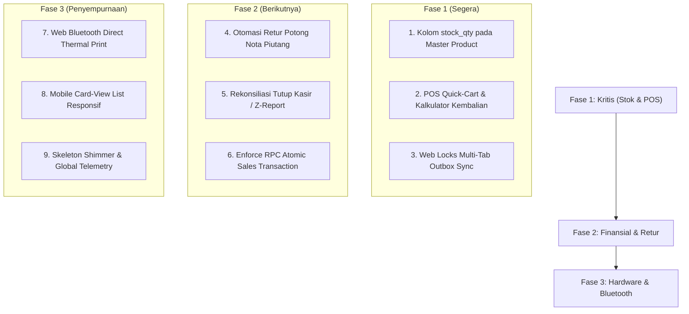

# SnackLoop ERP - Comprehensive System Audit & Improvement Roadmap

> **Tanggal Audit:** 09 November 2026  
> **Versi Aplikasi:** 2.6.0  
> **Standar Audit:** Ponytail Audit, Apple Design WWDC Guidelines, Enterprise Database & Security Integrity.

---

## 1. Executive Summary & Status Sistem

| Domain | Status Saat Ini | Skor Kematangan | Area Kunci Perbaikan |
|---|---|:---:|---|
| **Keamanan & Autentikasi** | SHA-256 / Bcrypt RPC, P1 Security Isolasi Password | **92 / 100** | Offline auth fallback token & Session TTL auto-lock |
| **Integritas Data & Database** | Stored Procedure Atomic Sales, PostgreSQL Indexes, Check Constraints | **90 / 100** | Penegakan RPC di kasir & Multi-tab Web Locks |
| **Fitur Bisnis & Inventori** | Repack Stock terisolasi, Buku Invoice, Retur, Jastip | **82 / 100** | Stok produk Master/Supplier, Keranjang Kasir & Hitung Kembalian |
| **Arsitektur Offline & Sync** | IndexedDB keyval, Outbox Queue, Realtime Supabase | **88 / 100** | Web Lock API anti duplikasi sync & Quota storage alert |
| **UI/UX & Apple Design** | Spring physics tokens, Frosted Glass, Gestur Swipe Sheet | **94 / 100** | Mobile Responsive Card-View & Shimmer Loading Skeleton |
| **Hardware & Pencetakan** | Struk Thermal 58mm/80mm via iframe print dialog | **85 / 100** | Web Bluetooth direct printing (RAW ESC/POS) & QRIS |

---

## 2. Prioritas Kritis (Must Add & Improve)
*Area yang langsung berdampak pada keandalan operasional kasir, pencegahan selisih uang, dan keamanan data.*

### 2.1. Pelacakan Stok Produk Master (Supplier Goods) & Peringatan Stok Menipis
- **Kondisi Saat Ini:**
  Saat ini kuantitas stok hanya dihitung pada produk olahan **Repack** (`repackData[i].remaining_qty`). Produk yang bersumber dari **Supplier** di tabel `master` (`masterData`) hanya memiliki data harga beli (`buy`) dan jual (`sell`), tanpa kuantitas stok (`stock_qty`). Akibatnya, kasir dapat menjual barang supplier tanpa batas meskipun fisik barang di gudang sudah kosong. Laporan inventori (`12-reports.js:renderReportInventory()`) juga hanya menghitung valuasi dari batch repack.
- **Rekomendasi Penambahan:**
  1. Tambahkan kolom `stock_qty` (integer default 0) dan `min_stock_alert` (default 5) pada tabel `master`.
  2. Kurangi stok produk master saat transaksi kasir tersimpan, dan kembalikan stok jika transaksi dihapus/dibatalkan.
  3. Berikan *Low Stock Alert* (badge oranye/merah) di dropdown kasir jika stok $\le$ batas minimum.
  4. Gabungkan valuasi produk Master ke dalam Laporan Valuasi Aset Gudang.

### 2.2. Keranjang Belanja Kasir (POS Multi-Item Cart) & Hitung Kembalian Tunai
- **Kondisi Saat Ini:**
  Form kasir utama (`t-form` di `11-transactions.js`) saat ini menginput produk **satu per satu baris per klik**. Meskipun nota harian otomatis digabungkan, kasir meja depan (POS) membutuhkan alur belanja cepat di mana pelanggan membeli 3–5 jenis snack sekaligus dalam satu transaksi struk. Selain itu, kasir belum memiliki kalkulator uang diterima vs kembalian.
- **Rekomendasi Penambahan:**
  1. **Quick-Cart Kasir**: Tabel keranjang sementara di tab Kasir sebelum tombol "Simpan & Cetak Struk" ditekan.
  2. **Kalkulator Uang Diterima & Kembalian (*Cash Tendered & Change*)**:
     - Kasir mengklik tombol nominal cepat (Rp 20.000, Rp 50.000, Rp 100.000, Uang Pas).
     - Sistem langsung menampilkan uang kembalian secara besar dan mencetaknya di bagian bawah struk thermal.

### 2.3. Mekanisme Kredensial Offline Aman (*Secure Offline Auth Vault*)
- **Kondisi Saat Ini:**
  Di `src/modules/06-auth.js`, login offline memeriksa `userData` lokal (`localUser.password === hashedInput`). Namun, demi keamanan, query `loadDataFromCloud()` sengaja tidak men-select kolom `password`. Akibatnya, jika kasir me-refresh halaman saat offline, data `password` pada memori tidak ada dan kasir tidak bisa login offline.
- **Rekomendasi Penambahan:**
  - Buat **Offline Credential Hash Vault** di IndexedDB (terisolasi dan di-hash SHA-256 dengan salt perangkat unik) hanya untuk staf kasir yang sebelumnya pernah berhasil login online di perangkat tersebut.
  - Tambahkan fitur *Quick PIN Switch* (4-6 digit PIN lokal) untuk kasir berganti giliran shift tanpa perlu mengetik ulang password utama.

### 2.4. Pencegahan Race Condition Multi-Tab dengan Web Locks API
- **Kondisi Saat Ini:**
  Jika kasir membuka SnackLoop ERP di dua tab browser sekaligus (misal satu tab untuk kasir dan satu tab untuk laporan), `syncOutboxQueue()` pada kedua tab dapat berjalan bersamaan saat koneksi internet pulih. Hal ini berpotensi mengirim antrean yang sama dua kali (*duplicate REST request*).
- **Rekomendasi Penambahan:**
  - Gunakan `navigator.locks.request('snackloop_sync_lock', async () => { ... })` di `src/modules/04-outbox.js`. Hanya satu tab yang diizinkan memproses antrean outbox ke Supabase pada satu waktu.

---

## 3. Prioritas Operasional & Keuangan (Should Add & Improve)
*Fitur yang mengotomasi pembukuan, mencegah selisih piutang, dan meningkatkan produktivitas harian.*

### 3.1. Otomasi Retur Pemotongan Nota Piutang (*Return-to-Invoice Offset*)
- **Kondisi Saat Ini:**
  Modul Retur (`src/modules/13-returns.js`) menyediakan opsi aksi `potong_nota` (potong tagihan nota). Namun saat retur disimpan/diselesaikan, nilai `total_amount` pada faktur pelanggan di tabel `invoices` belum terpotong otomatis, sehingga admin kasir harus menghitung dan mengedit sisa tagihan secara manual.
- **Rekomendasi Penambahan:**
  - Buat trigger/helper otomatis: Ketika klaim retur berstatus `Selesai (Potong Nota)`, kurangi `total_amount` invoice referensi sebesar nilai retur, atau buat baris *Kredit Nota (Credit Memo)* yang tercantum transparan di lembar cetak PDF tagihan pelanggan.

### 3.2. Rekonsiliasi Kas Harian Kasir / Tutup Kasir (*Cash Drawer & Z-Report*)
- **Kondisi Saat Ini:**
  Laporan P&L di `12-reports.js` mencatat pendapatan akrual (seluruh penjualan tunai + tempo). Belum ada fitur **Buku Kas Fisik (Cash Drawer Reconciliation)**:
  - Berapa uang modal awal di laci kasir (kas kecil/float).
  - Berapa uang tunai yang masuk hari ini dari penjualan lunas.
  - Berapa uang tunai yang masuk dari pelunasan nota-nota lama.
  - Berapa pengeluaran tunai (beli bensin, pulsa, lakban, dsb).
  - Berapa seharusnya uang fisik di laci saat kasir tutup toko (*Z-Report*).
- **Rekomendasi Penambahan:**
  - Tambahkan tab/modal **Tutup Kasir Harian**: Kasir memasukkan hitungan fisik lembaran uang (pecahan 100rb, 50rb, dsb). Sistem menghitung selisih kas (*over/short*) dan mencetak ringkasan struk tutup kasir harian (*Shift End Receipt*).

### 3.3. Eksekusi Stored Procedure Atomik Sebagai Alur Kasir Utama
- **Kondisi Saat Ini:**
  Skrip database `database/rpc_atomic_sales.sql` (`create_sale_transaction_atomic`) sudah disiapkan dengan penguncian `FOR UPDATE` ACID. Namun di kode JavaScript kasir, pemanggilan masih menggunakan fallback insert direct terpisah ke tabel `transactions` lalu tabel `invoices`.
- **Rekomendasi Penambahan:**
  - Jadikan RPC `create_sale_transaction_atomic` sebagai panggilan utama saat online. Jika ada kendala jaringan, masukkan ke antrean outbox untuk di-sync via RPC tersebut.

---

## 4. Prioritas Pengalaman Pengguna & Hardware (Nice to Have & Polish)
*Meningkatkan kenyamanan visual, ergonomi mobile, dan integrasi perangkat kasir fisik.*

### 4.1. Web Bluetooth Direct Printing untuk Printer Kasir Portabel
- **Kondisi Saat Ini:**
  Cetak struk di `src/modules/16-printer.js` menggunakan hidden iframe yang memicu dialog cetak bawaan browser. Pada Android/iOS, dialog sistem operasi sering kali menampilkan preview PDF dan membutuhkan beberapa ketukan tombol sebelum printer mencetak.
- **Rekomendasi Penambahan:**
  - Integrasikan **Web Bluetooth API** (`navigator.bluetooth` dengan UUID Serial Port Profile ESC/POS). Kasir dapat melakukan pairing langsung dengan printer mini Bluetooth 58mm (seperti Panda, RPP02N, VSC) dan mencetak struk secara instan dalam 1 detik tanpa popup dialog.
  - Sertakan generator QRIS statis di bawah struk untuk kemudahan pembayaran nontunai pelanggan.

### 4.2. Tampilan Kartu Responsif Mobile (*Mobile Card-View List*)
- **Kondisi Saat Ini:**
  Tabel transaksi dan invoice pada layar smartphone menampilkan scroll horizontal (overflow-x).
- **Rekomendasi Penambahan:**
  - Pada breakpoint mobile (`max-width: 640px`), berikan opsi toggle tampilan **Card List ala iOS**: Setiap transaksi atau invoice tampil sebagai kartu rapi dengan status warna, tanggal, nominal tebal, dan gestur swipe kiri untuk aksi cetak/hapus.

### 4.3. Animasi Shimmer Skeleton Loader
- **Kondisi Saat Ini:**
  Saat aplikasi pertama kali memuat data dari Supabase, indikator loading berupa teks statis *"Memuat data dari cloud..."*.
- **Rekomendasi Penambahan:**
  - Pasang **Skeleton Shimmer Screens** pada tabel kasir dan kartu KPI Dashboard saat memuat data, memberikan kesan responsif instan dan modern khas aplikasi native iOS/macOS.

### 4.4. Telemetri & Global Error Catching
- **Kondisi Saat Ini:**
  Jika terjadi uncaught exception atau kuota IndexedDB mendekati batas penuh, error hanya tercetak di console browser.
- **Rekomendasi Penambahan:**
  - Pasang listener `window.addEventListener('error')` dan `unhandledrejection` yang otomatis mencatat log kendala ke tabel `audit_logs` lokal dengan tombol *"Salin Log Diagnostik"* di Pengaturan untuk mempermudah investigasi tim developer.

---

## 5. Roadmap Tahapan Eksekusi

